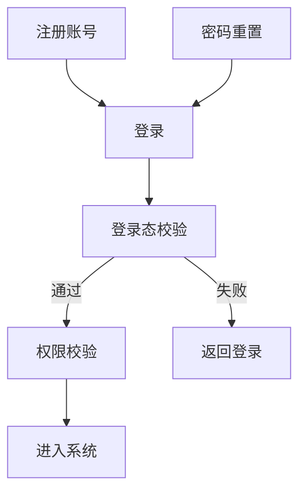

# Markdown to PDF

Turn plain Markdown into a polished, print-ready PDF — right in your browser.

> **Tip:** Edit anything on the left and the preview updates instantly. When it
> looks right, hit **Download PDF**.

## Why it's nice

- ✅ **Free & unlimited** — no sign-up, no watermark, no file limits.
- 🔒 **Private** — conversion happens on *your* device. Nothing is uploaded.
- ✍️ **Live preview** — what you see is exactly what gets printed.
- 🧩 **GitHub-flavored** — tables, task lists, code blocks, footnotes and more.

## Formatting examples

You can use **bold**, _italic_, ~~strikethrough~~, `inline code`, and
[links](https://md2any.com).

### Task list

- [x] Write some Markdown
- [x] See the live preview
- [ ] Download the PDF

### Table

| Feature        | Supported |
| -------------- | :-------: |
| Headings       |    ✓      |
| Tables         |    ✓      |
| Code blocks    |    ✓      |
| Images         |    ✓      |

### Code block

```js
function greet(name) {
  return `Hello, ${name}! 👋`;
}

console.log(greet("world"));
```

### Blockquote

> "The best way to predict the future is to invent it."
> — Alan Kay

---


Made something nice? Just click **Download PDF** in the toolbar above. ✨

## 补充示例（mdany）

### 嵌套列表与有序列表

1. 第一步：准备材料
   - 需求文档
   - 设计文档
2. 第二步：转换
   1. 先转 PDF
   2. 再转 Word

### 脚注

软著材料要求源代码每页不少于 50 行[^lines]。

[^lines]: 本示例的 `阶段6/6.1-源代码摘录.md` 演示按页分页和页眉。

### 本地图片（相对路径，中文目录）


### 宽表格

| 字段 | 类型 | 必填 | 默认值 | 说明 |
|---|---|:-:|---|---|
| id | bigint | 是 | 自增 | 主键 |
| title | varchar(200) | 是 | 空 | 任务标题，长文本会自动换行，不会撑破页面宽度 |
| status | tinyint | 是 | 0 | 0 待办，1 进行中，2 已完成 |
